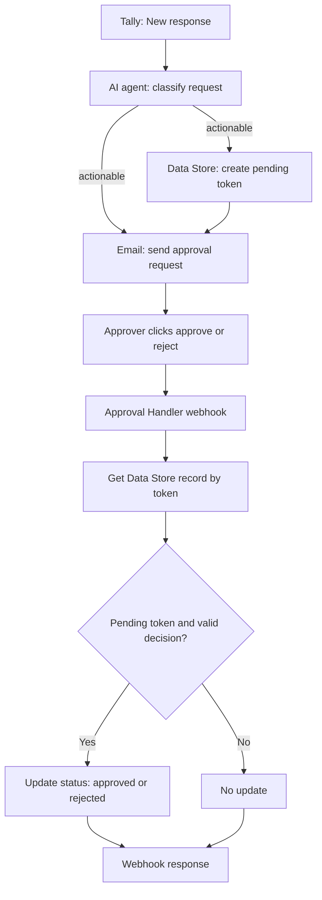

# System architecture

## Scenario A: Integration Tally

Exported module sequence:
1. **Tally — Watch New Response** (`tally:watchNewResponse`): receives a new Tally response.
2. **Make AI Agent — Classify change request** (`ai-local-agent:RunLocalAIAgent`): receives the incoming Tally payload and returns structured triage fields.
3. **Data Store — Create one-time approval token** (`datastore:AddRecord`): runs only when `classification` equals `actionable`; stores a UUID-keyed record with `pending` status, `pending` decision, creation timestamp and summary as `request_id`.
4. **Google Email — Email approval request** (`google-email:sendAnEmail`): also filtered to actionable requests; emails the summary, priority, component, category, detailed description, acceptance criteria, duplicate notes and approve/reject links.

The two actionable-only modules are separate filtered branches after the AI agent in the exported flow.

## Scenario B: Change Request Approval Handler

Exported module sequence:
1. **Custom Webhook** (`gateway:CustomWebHook`): receives `token` and `decision`.
2. **Data Store — Find approval token** (`datastore:GetRecord`): retrieves the record using the token as the key.
3. **Data Store — Record first decision only** (`datastore:UpdateRecord`): runs only when the stored status is `pending` and the decision is either `approve` or `reject`; updates status to `approved` or `rejected` and stores the decision.
4. **Webhook Response** (`gateway:WebhookRespond`): returns a confirmation message.

## Connection between scenarios

The Integration Tally scenario creates the token in Data Store `242031` and inserts that token into the approval/rejection links. The Change Request Approval Handler looks up the same Data Store record by token. Both exports refer to Data Store ID `242031` in the source Make environment.

## Mermaid overview

## Important scope note

The uploaded blueprints do **not** contain a GitHub module or a GitHub Issue creation step. They currently implement Tally intake, AI triage, an email-based approval request, and approval-state recording. GitHub issue creation must be added as a further workflow step after approval if that is the intended end state.
